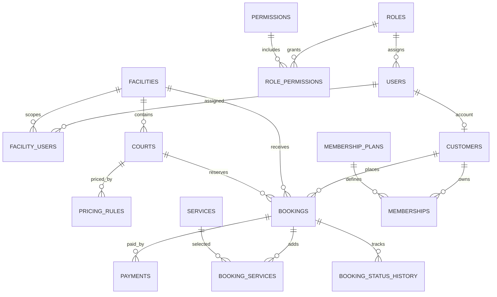

# PickleHub

PickleHub là nền tảng quản lý sân Pickleball viết bằng PHP 8.2+, PDO và MySQL/MariaDB. Bản hiện tại triển khai nền tảng MVC, đăng nhập an toàn, phân quyền theo vai trò/cơ sở và dashboard đọc trực tiếp dữ liệu MySQL.

## Cấu trúc

- `app/Core`: nạp cấu hình, PDO, session/CSRF, phân quyền, router và view.
- `app/Controllers`, `app/Views`, `app/Helpers`: luồng xử lý MVC và giao diện.
- `database/schema.sql`, `database/seed.sql`: schema và dữ liệu cơ sở demo.
- `public`: web root, front controller, CSS và rewrite.
- `scripts/create-admin.php`: tạo Super Admin từ dòng lệnh, không có mật khẩu mẫu trong SQL.

## Cài trên XAMPP / Laragon

1. Cài PHP 8.2 trở lên, MySQL 8 (hoặc MariaDB tương thích) và bật extension `pdo_mysql`.
2. Tạo cấu hình bằng cách sao chép `.env.example` thành `.env`; đặt `DB_*` và `APP_KEY`. Để `APP_URL` trống để tự nhận thư mục con hiện tại, hoặc khai báo URL đầy đủ nếu cần. Không đưa `.env` lên Git.
3. Mở phpMyAdmin hoặc MySQL client, import `database/schema.sql`, sau đó import `database/seed.sql`. Seed chỉ thêm role, quyền và một cơ sở/sân demo; không tạo tài khoản đăng nhập mặc định.
4. Chạy migration khách hàng, hội viên và điểm thưởng: `migrations/20261029_customer_membership_loyalty.sql`.
5. Chạy tiếp migration hóa đơn, tiền cọc và hoàn tiền: `migrations/20261029_payment_invoice_refunds.sql`. Có thể chạy từng tệp trong phpMyAdmin hoặc từ Command Prompt tại thư mục dự án:

   ```cmd
   C:\xampp\mysql\bin\mysql.exe -u root -p picklehub < migrations\20261029_customer_membership_loyalty.sql
   C:\xampp\mysql\bin\mysql.exe -u root -p picklehub < migrations\20261029_payment_invoice_refunds.sql
   ```

   Migration tài chính backfill hóa đơn và dòng thuê sân cho đặt chỗ hiện có; một số khoản thu cũ được nhận diện là cọc khi khoản đầu tiên không vượt quá tiền cọc đã lưu. Không chạy lại migration tài chính sau khi đã áp dụng.
6. Chạy migration dịch vụ/kho, giải đấu, nhân sự, chấm công và chi phí: `migrations/20261029_operations_tournaments_staff.sql`.
7. (Tùy chọn) Nạp dữ liệu giả lập sau khi cả ba migration đã chạy. Import lần lượt `database/seed_demo.sql`, rồi `database/seed_operations_demo.sql`. Hai tệp chỉ thêm dữ liệu có mã/email `DEMO`/`example.test`, không xóa dữ liệu, không tạo user và có thể chạy lại an toàn. Trước khi nạp, hãy sao lưu database đang chứa dữ liệu cần giữ. Dùng phpMyAdmin chọn database `picklehub` rồi import từng tệp, hoặc từ Command Prompt:

   ```cmd
   C:\xampp\mysql\bin\mysql.exe -u root -p picklehub < database\seed_demo.sql
   C:\xampp\mysql\bin\mysql.exe -u root -p picklehub < database\seed_operations_demo.sql
   ```

   Seed nghiệp vụ cơ bản tạo sân, khách hàng, hội viên, đặt sân, hóa đơn, thanh toán và hoàn tiền. Seed vận hành thêm tối thiểu 15 vợt, 25 đồ uống, 25 phụ kiện, 10 phiếu thuê, 10 phiếu nhập, 30 đơn bán với ít nhất 60 dòng hàng, 30 giao dịch thanh toán và 3 giao dịch trả/hoàn tiền; đồng thời tạo lịch sử kho và trạng thái tồn khác nhau. Seed vận hành còn có 5 giải, 30 đăng ký, 20 trận, 12 hồ sơ nhân viên, ca/lịch chấm công và 20 khoản chi. Bản seed không bật tự động khi mở website, không tạo tài khoản đăng nhập và không dùng thông tin cá nhân thật; chạy lại không thêm trùng dữ liệu demo.
8. (Tùy chọn) Tạo hồ sơ đăng nhập nhân viên demo từ PowerShell tại thư mục dự án: `php scripts/create-demo-staff.php`. Script tạo mật khẩu ngẫu nhiên riêng cho từng nhân viên còn hoạt động và chỉ in chúng một lần trong terminal; không lưu mật khẩu rõ trong database hoặc file. Để đồng thời tạo tài khoản Super Admin thử nghiệm có mật khẩu ngẫu nhiên, chạy `php scripts/create-demo-staff.php --include-admin`; tài khoản này chỉ được tạo nếu chưa có và tuyệt đối không đổi quyền/mật khẩu của account đang tồn tại.
9. Autoloader PSR-4 nội bộ giúp chạy được ngay mà không cần package ngoài. Nếu dùng Composer, có thể chạy `composer dump-autoload`.
10. Tạo quản trị viên trong PowerShell từ thư mục dự án:

   ```powershell
   php scripts/create-admin.php "Quản trị PickleHub" admin@example.com "MatKhauDaiVaNgauNhien"
   ```

   Mật khẩu phải có tối thiểu 12 ký tự. Tránh đặt mật khẩu thật trong lịch sử lệnh trên máy dùng chung.
11. Cấu hình Apache DocumentRoot trỏ đến thư mục `public`; bật `mod_rewrite` và cho phép `.htaccess`. Nếu đang chạy trong thư mục con như `web14c4/quanlysanpick`, để `APP_URL` trống để ứng dụng tự nhận đường dẫn hiện tại.
12. Mở `APP_URL/login`, đăng nhập và kiểm tra dashboard. Dashboard không bịa doanh thu; khi chưa có thanh toán được ghi nhận, số liệu bằng 0 và biểu đồ hiển thị trạng thái rỗng.

## Kiểm tra cấu hình bảo mật

- PDO dùng prepared statements và exception mode.
- Mật khẩu dùng `password_hash` / `password_verify`; form có CSRF token; output HTML được escape.
- Session cookie bật `HttpOnly`, `SameSite=Lax`; session ID được đổi khi đăng nhập.
- Có giới hạn đăng nhập sai theo email/IP; giới hạn này áp dụng ở server và được lưu trong `login_attempts`.
- Vai trò được seed trong SQL; chủ sân/quản lý chỉ nhận dữ liệu thuộc cơ sở gắn trong `facility_users`. Tài khoản được tạo qua script có vai trò Super Admin.
- Đăng ký công khai tạo người dùng với role `customer` và hồ sơ liên kết trong `customers` trong cùng transaction; vai trò quản trị không nhận từ biểu mẫu.
- Không cấu hình API thanh toán hoặc AI mặc định. Chỉ bật các tích hợp sau khi có thông tin xác thực và quy trình xác minh phía server.

## Đăng ký và đăng nhập

- Mở `APP_URL/register` để tạo tài khoản khách hàng; đăng ký thành công sẽ tự đăng nhập và chuyển đến `/customer`.
- Đăng nhập tại `APP_URL/login`. Khách hàng được chuyển đến `/customer`; tài khoản nhân viên/quản trị được chuyển đến `/dashboard` và vẫn phải có quyền `dashboard.view`.
- Đăng xuất bằng biểu mẫu POST có CSRF token. Người dùng công khai không thể chọn role; backend luôn lấy role `customer` từ bảng `roles`.
- Tài khoản quản trị/nhân viên được tạo bởi quản trị viên qua script CLI `scripts/create-admin.php`, không qua biểu mẫu đăng ký công khai.

## Các module hiện đã chạy

- Đăng ký khách hàng, đăng nhập/đăng xuất và trang khách hàng; vai trò công khai luôn là `customer`.
- Quản lý sân: tìm/lọc/phân trang, thêm/sửa, cập nhật giá giờ cơ bản, đổi trạng thái sang hoạt động/bảo trì/ngừng.
- Đặt sân: danh sách và bộ lọc; khách đặt/hủy đơn của mình; nhân viên tạo khách tại quầy, xác nhận/check-in/hoàn tất/hủy/đánh dấu vắng. Việc đặt khóa hàng sân trong transaction, kiểm tra giờ hoạt động, bảo trì, bảng giá và giao nhau lịch ở backend.
- Thanh toán & hóa đơn: hóa đơn duy nhất theo lượt đặt, dòng giá thuê/ưu đãi chụp tại thời điểm đặt, lịch sử nhiều khoản thu, loại tiền cọc/công nợ/bổ sung, trạng thái hóa đơn suy ra từ thu và hoàn đã xác nhận, tra cứu/phân trang/CSV, in từ trình duyệt, bộ lọc giao dịch và báo cáo dòng tiền.
- Tiền cọc: cấu hình cố định hoặc tỷ lệ phần trăm theo quy tắc giá, sân và khung giờ; tiền cọc phải nộp được chụp trên hóa đơn/lượt đặt nên đổi cấu hình không thay các lượt cũ.
- Hoàn tiền: nhân viên tạo yêu cầu; người có quyền khác phê duyệt; chỉ người có quyền xác nhận hoàn tất sau khi chi trả tiền mặt/chuyển khoản thực tế. Mỗi giao dịch hoàn liên kết khoản thu gốc, giới hạn số tiền còn hoàn, có idempotency/lịch sử/audit và điều chỉnh điểm tương ứng mà không để số dư điểm âm.
- Khách hàng: tìm kiếm theo mã/tên/email/điện thoại, lọc loại/gói/trạng thái, phân trang, CSV, tạo/liên kết/sửa/khóa hồ sơ, thống kê lượt/tiền đã thu, lịch sử đặt sân/thanh toán/hội viên/điểm và ghi sổ điều chỉnh điểm. Tài khoản đăng nhập được đồng bộ hồ sơ; trang khách hàng chỉ cho sửa hồ sơ của chính mình.
- Hội viên: cấu hình gói, quyền lợi, thời hạn theo ngày/tháng/năm, mức giảm và hệ số tích điểm; khách gửi yêu cầu thanh toán thủ công đang chờ, nhân viên có quyền xác nhận sau khi đối chiếu tiền. Gói miễn phí được kích hoạt không ghi nhận thanh toán. Khi xác nhận gói có phí, giao dịch và nhân viên được lưu; gia hạn nối tiếp sau ngày hết hạn hiện tại và thao tác xác nhận lặp không kích hoạt hai lần. Nhân viên có quyền có thể chấm dứt gói và phải ghi lý do; không tự hoàn tiền.
- Điểm thưởng: quy tắc tiền/điểm mặc định tắt (0) đến khi quản trị cấu hình; chỉ khoản thu đặt sân trạng thái đã xác nhận mới có thể phát sinh điểm. Mỗi khoản thu có khóa sự kiện duy nhất; phần thưởng trừ điểm trong transaction, hủy yêu cầu sẽ hoàn bằng một giao dịch mới, không xóa sổ lịch sử.
- Dữ liệu demo: sau khi migration, có thể nhập `database/seed_demo.sql`; mọi bản ghi mẫu được đánh dấu `DEMO` và không tạo user/password demo. Bản seed không bật tự động khi mở website.
- Sản phẩm/kho và bán hàng: catalog theo cơ sở, nhập kho, điều chỉnh có sổ ledger, đơn bán, thu một hoặc nhiều lần, hủy đơn chưa thanh toán để hoàn tồn trong transaction, yêu cầu trả hàng có duyệt và chỉ cộng lại tồn khi hoàn tất.
- Thuê vợt: danh mục vợt, khóa khi bàn giao, tính phí theo giờ thực tế lúc nhận trả, lưu tiền cọc/thu cuối và lịch sử giao dịch.
- Dịch vụ khách hàng: `/customer/store` hiển thị nước uống/phụ kiện theo tồn kho cơ sở, tạo đơn chờ thanh toán tại quầy, cho phép hủy đơn chưa thu tiền và lưu lịch sử; `/customer/rackets` gửi/hủy yêu cầu thuê theo khung giờ, kiểm tra trùng lịch và chỉ xác nhận bàn giao bởi nhân viên có quyền.
- Giải đấu: tạo/sửa giải, tìm/lọc, đăng ký đội, ghi nhận lệ phí, đóng/mở đăng ký, chia bảng vòng tròn, xếp lịch một sân và ghi kết quả có audit. Chưa tạo nhánh loại trực tiếp; lịch nhóm hiện xếp tuần tự theo slot 90 phút trên một sân.
- Nhân viên và chấm công: hồ sơ, ca, phân ca chống trùng giờ, tự chấm công theo tài khoản đã liên kết và gửi yêu cầu sửa; quản lý duyệt yêu cầu. Hồ sơ/ca/chấm công hiện chưa có quan hệ cơ sở trong schema nên lịch làm và báo cáo giờ công là toàn hệ thống.
- Chi phí: tạo khoản chi chờ duyệt, người khác duyệt/từ chối, sau đó mới ghi nhận đã thanh toán; người tạo không thể tự duyệt khoản của mình. Danh mục chi phí có thể thêm.
- Báo cáo vận hành `/operations/reports`: tổng hợp tiền đặt sân, bán hàng trừ trả hàng, thuê vợt, lệ phí giải và chi phí đã thanh toán theo ngày/cơ sở; giờ công không lọc cơ sở do schema nhân sự hiện tại.
- Tài khoản nhân viên demo tách biệt hồ sơ: `php scripts/create-demo-staff.php` tạo tài khoản giới hạn quyền, mật khẩu ngẫu nhiên chỉ in một lần ra terminal; `--include-admin` tùy chọn tạo một Super Admin demo riêng, không đổi account có sẵn.
- Những tích hợp không có schema/nhà cung cấp thật (máy POS, vị trí chấm công, dữ liệu thiết bị, tài khoản ngân hàng) không được mô phỏng là đã xác minh.
- Ưu đãi hội viên: mức giảm cấu hình được áp dụng khi tạo đặt sân; giá gốc, phần trăm giảm và tiền giảm được lưu riêng để đối soát. Không thay đổi giá của các lượt đặt đã tạo trước đó.
- Báo cáo: doanh thu theo ngày/sân, lượt theo trạng thái, tỷ lệ sử dụng theo lịch hoạt động/bảo trì, lọc ngày/cơ sở và CSV.
- Dashboard lấy số liệu PDO từ MySQL; doanh thu theo ngày/tháng và biểu đồ hợp nhất khoản thu đặt sân, bán hàng, thuê vợt, lệ phí giải và trừ các khoản hoàn đã thực hiện; công nợ gồm hóa đơn sân, đơn bán, tiền thuê đã trả vợt và lệ phí giải chưa thu. Tiền cọc đặt sân không cộng lần nữa vào giá trị hóa đơn.

Các module thông báo, AI, quản trị lịch nghỉ và huấn luyện viên chuyên biệt chưa được triển khai. Phí hội viên trong `membership_orders` vẫn theo luồng riêng, chưa hợp nhất vào dashboard/báo cáo doanh thu tổng. Báo cáo vận hành không tính giá vốn, lương, chi phí chưa thanh toán hoặc dữ liệu thanh toán ngoài các bảng nêu trên; chênh lệch không phải lợi nhuận kế toán. Chưa có cổng thanh toán trực tuyến/PDF server-side; hóa đơn có thể in hoặc lưu PDF từ trình duyệt. Chưa có chính sách tự động quyết toán cọc khi hủy sân: nhân viên phải căn cứ chính sách hợp lệ để gửi yêu cầu hoàn tiền.

Để thử đặt sân demo, giá mẫu rõ nhãn demo được thêm qua `database/seed.sql`; trên database đã seed từ trước, hãy chạy lại phần pricing insert trong tệp này hoặc tạo giá tại trang Quản lý sân.

## Các đường dẫn nghiệp vụ

- `/dashboard`: dashboard quản trị.
- `/courts`: quản lý sân và giá cơ bản.
- `/bookings`: đặt/quản lý lịch sân.
- `/customers`: hồ sơ khách hàng.
- `/memberships`: quản lý gói, xác nhận thanh toán hội viên, cấu hình điểm và phần thưởng (theo permission).
- `/payments`: tổng quan thu tiền/cọc/công nợ/hoàn tiền.
- `/payments/invoices`, `/payments/invoice?id=...`: danh sách, chi tiết và bản in hóa đơn.
- `/payments/receivables`: công nợ hiện tại theo khách hàng/hóa đơn, có liên kết thu nợ.
- `/payments/transactions`: thu tiền, phân loại cọc/công nợ và tra cứu giao dịch.
- `/payments/refunds`: tạo/duyệt/xác nhận/hủy yêu cầu hoàn; `/payments/deposits`: cấu hình cọc; `/payments/reports`: báo cáo và CSV.
- `/customer/invoices`: hóa đơn của chính khách hàng đang đăng nhập.
- `/reports`: báo cáo và xuất CSV.
- `/inventory`, `/sales`: sản phẩm, nhập/điều chỉnh kho, đơn hàng, thanh toán và trả hàng.
- `/rackets`, `/rentals`: quản lý vợt, bàn giao, thu cọc, nhận trả và đối soát tiền thuê.
- `/tournaments`: giải đấu, đăng ký, lệ phí, bảng, lịch và kết quả.
- `/operations/staff`, `/operations/shifts`, `/operations/attendance`: hồ sơ nhân viên, ca làm, phân ca và chấm công.
- `/operations/expenses`, `/operations/reports`: chi phí vận hành và báo cáo tổng hợp.
- `/customer`: trang khách hàng.
- `/customer/profile`: hồ sơ cá nhân.
- `/customer/memberships`: gói hiện có và yêu cầu đăng ký/gia hạn.
- `/customer/points`: số dư, sổ giao dịch và đổi thưởng.

## Kiểm thử module khách hàng / hội viên

1. Chạy migration trên database đã import schema và seed. Đăng nhập bằng Super Admin hoặc tài khoản `owner` / `facility_manager` có permission sau migration.
2. Tại `/customers`, thêm một hồ sơ bằng email đã đăng ký để kiểm tra liên kết account; thử tìm bằng ID, lọc hội viên/trạng thái và xuất CSV. Mở hồ sơ để kiểm tra lịch sử và khóa/mở khóa.
3. Tại `/memberships`, tạo một gói thử với mức giá/quyền lợi được quản trị viên duyệt; tạo phần thưởng và cấu hình tiền/điểm (mặc định để 0 nếu chưa quyết định chính sách).
4. Đăng nhập tài khoản khách hàng, mở `/customer/memberships`, gửi yêu cầu bằng tiền mặt hoặc chuyển khoản. Trạng thái phải là chờ xác nhận và chưa có membership hiệu lực.
5. Nhân viên có quyền hội viên chỉ xác nhận sau khi đối chiếu giao dịch thật. Kiểm tra ngày bắt đầu/kết thúc, lặp lại thao tác xác nhận và xác minh chỉ có một membership được tạo.
6. Cấu hình quy tắc tích điểm lớn hơn 0, ghi nhận khoản thanh toán đặt sân qua `/payments/transactions` và kiểm tra điểm ledger. Gửi lại cùng idempotency key không được tạo khoản thu/điểm lần hai.
7. Dùng điểm đổi phần thưởng, kiểm tra không thể vượt số dư; hủy yêu cầu từ trang quản trị để kiểm tra giao dịch hoàn điểm.
8. Tạo đặt sân bằng khách hàng có gói còn hiệu lực và kiểm tra giá cuối cùng/chi tiết giảm trong `booking_price_details`; tài khoản khách khác không được đọc hồ sơ cá nhân, điểm hay lịch sử của người này.

## Kiểm thử module thanh toán / hóa đơn

1. Sau khi chạy cả hai migration, tạo lượt đặt; xác nhận chỉ có một hóa đơn với giá gốc/giảm giá/tiền cọc đúng và xem được từ danh sách đặt sân.
2. Tại `/payments/deposits`, đặt cọc cố định hoặc phần trăm cho một quy tắc giá; tạo lượt đặt mới và xác nhận lượt cũ không đổi số cọc.
3. Thu tiền cọc một phần, thu nhiều lần phần còn lại; xác nhận công nợ bằng tổng hóa đơn trừ các khoản thu đã xác nhận, tiền cọc không bị cộng đôi và không thể thu vượt.
4. Tạo yêu cầu hoàn từ hóa đơn; thử người yêu cầu tự duyệt (phải bị từ chối), duyệt bởi người có quyền khác và chỉ xác nhận hoàn tất sau khi chi trả thực tế.
5. Thử hoàn vượt khoản thu gốc, tạo hai yêu cầu dùng chung tiền, gửi lại idempotency key và hoàn trùng; hệ thống phải chặn các thao tác không hợp lệ.
6. Xác nhận hoàn tiền: lịch sử khoản thu gốc còn nguyên, công nợ tăng theo công thức thu trừ hoàn, trạng thái hoàn hiển thị riêng và điểm thưởng được điều chỉnh qua ledger.
7. So sánh dashboard/báo cáo theo ngày, sân, phương thức với các payment/refund đã xác nhận; thử CSV và in hóa đơn.
8. Đăng nhập customer, kiểm tra chỉ xem được hóa đơn của tài khoản đó; kiểm tra role receptionist không thể duyệt/xác nhận hoàn nếu thiếu permission.

## Kiểm thử module vận hành

1. Sau schema gốc, các migration khách hàng/hội viên và tài chính, chạy `migrations/20261029_operations_tournaments_staff.sql`; sau đó nhập `database/seed_operations_demo.sql`. Cả hai bước không tự chạy khi mở website; hãy sao lưu database trước khi cập nhật.
2. Tạo tài khoản nhân viên demo bằng `php scripts/create-demo-staff.php`. Lưu mật khẩu ngẫu nhiên ở nơi an toàn ngay khi in ra terminal. Chỉ khi cần tài khoản quản trị demo, dùng `php scripts/create-demo-staff.php --include-admin`; không dùng tài khoản này ở môi trường công khai.
3. Mở `/inventory`, thử tìm/lọc, tạo sản phẩm, nhập kho và điều chỉnh tồn; đối chiếu tồn hiện tại với sổ biến động. Tại `/sales`, tạo đơn có thu một phần, thu phần còn lại, gửi yêu cầu trả hàng, duyệt rồi hoàn tất; tồn chỉ tăng khi hoàn tất.
4. Tại `/rackets` và `/rentals`, tạo vợt/phiếu thuê, thu tiền cọc, nhận trả để tính phí giờ thực tế và ghi nhận phần còn lại; kiểm tra lịch sử thanh toán và trạng thái vợt.
5. Tại `/tournaments`, tạo giải, mở đăng ký, thêm đội, thu lệ phí, đóng đăng ký, chia bảng, xếp lịch và nhập kết quả; kết quả sửa lại phải có lịch sử audit.
6. Tại `/operations/staff` và `/operations/shifts`, tạo hồ sơ/ca và phân ca; tài khoản nhân viên được liên kết tại hồ sơ chỉ có thể tự chấm công ca của mình trong ngày. Thử gửi yêu cầu sửa giờ và duyệt bằng tài khoản quản lý khác.
7. Tại `/operations/expenses`, tạo khoản chi; người tạo không được tự duyệt. Người có quyền khác duyệt/từ chối; khoản đã duyệt mới có thể chuyển sang đã thanh toán.
8. So sánh dashboard và `/operations/reports` với giao dịch nguồn. Báo cáo vận hành lọc tài chính theo cơ sở/ngày; giờ công hiện là tổng hệ thống vì schema chưa gắn nhân sự với cơ sở.

## ERD nền tảng



Mọi giá trị tiền trong schema dùng `DECIMAL`; các liên kết cơ sở/sân/đơn có khóa ngoại và index. Việc ngăn trùng khung giờ cần xử lý trong transaction ứng dụng (khóa hàng sân rồi kiểm tra khoảng thời gian), vì unique constraint đơn thuần không thể áp dụng cho giao nhau của hai khoảng thời gian.

## Cấu hình AI, SMTP, thanh toán

`.env.example` khai báo chỗ cấu hình nhưng chưa bật tích hợp. AI cần provider/API URL/API key và lớp adapter có kiểm tra quyền; SMTP cần máy chủ gửi thư; thanh toán cần adapter, xác thực chữ ký webhook và khóa idempotency. Không nhập API key vào SQL hoặc commit `.env`.
